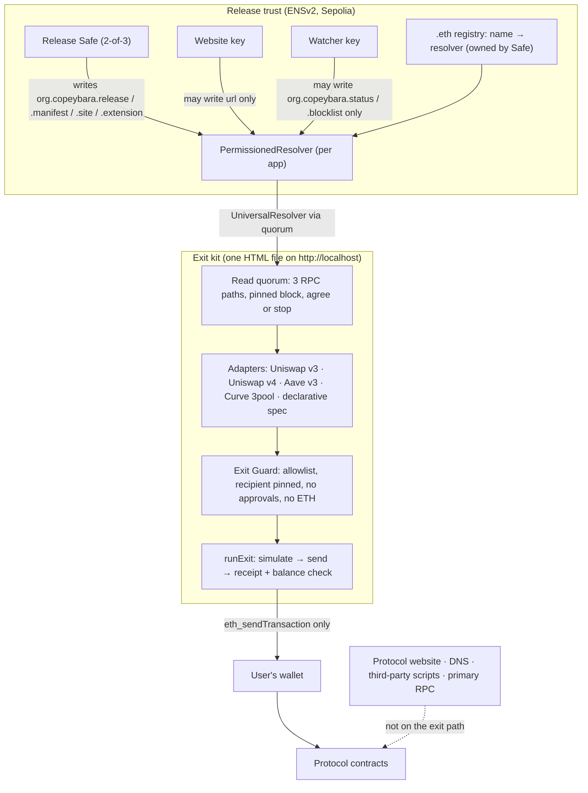

<p align="center">
  
</p>

<h1 align="center">Copeybara</h1>

<p align="center">
  <b>The emergency exit for DeFi.</b><br>
  When a protocol's website goes down or gets hijacked, your money is still in its contracts.<br>
  Copeybara gets you to them, verified by the protocol's own ENS name.
</p>

<p align="center">
  <a href="https://blackout-red.vercel.app"><b>Live site</b></a> ·
  <a href="https://blackout-red.vercel.app/copeybara-kit.html?ens=demoswap-blackout.eth"><b>Try an exit</b></a> ·
  <a href="#demo-video"><b>Demo video</b></a> ·
  <a href="https://blackout-red.vercel.app/#/docs"><b>Developer docs</b></a> ·
  <a href="#partner-tracks"><b>Partner tracks</b></a>
</p>

<p align="center">
  
  
  
  
</p>

<p align="center">
  
</p>

## TL;DR

- **The problem.** Some of DeFi's most painful losses never touched the contracts: the website was the weak point. DNS hijacks, poisoned third-party scripts and outages have drained or locked out users at Curve, Balancer, Ledger Connect Kit, Polymarket and a dozen Name.com sites, while the contracts underneath kept working.
- **What we built.** A one-file **exit kit** that withdraws your positions straight from the contracts, a **browser extension** that stops drainers before your wallet sees them, a **watcher agent** with its own ENS identity, and an **SDK** that lets any protocol publish all of it on its **ENSv2** name in under an hour.
- **Why it's different.** Nothing is trusted, everything is checked: the kit's fingerprint against ENS, every chain read against three RPCs, and every transaction against a fail-closed Exit Guard that can only ever pay you.
- **Proof.** A live rescue on Sepolia with the website, DNS and RPC switched off; the 2022 Curve hijack replayed on a mainnet fork (400,227.23 USDC lost without Copeybara, 0 with it); 696 of 697 real drainer requests stopped or held before signing; 917 automated tests.

## Demo video

<!--
  DEMO VIDEO: paste the link in both places below (YouTube, Loom or the ETHGlobal showcase URL)
  and delete the "coming soon" line. A thumbnail link works well on GitHub:
  [](https://www.youtube.com/watch?v=VIDEO_ID)
-->

> **Watch the demo:** the video is on our ETHGlobal Mumbai showcase page. Or [try a real exit on Sepolia](https://blackout-red.vercel.app/copeybara-kit.html?ens=demoswap-blackout.eth) in under a minute.

The video follows one user through a real attack on Sepolia: DemoSwap's site is hijacked and drains a wallet that has no protection; then the website and its RPC are switched off, and the same user exits every position with a saved kit that checks itself against ENS.

## The problem: the contracts were fine, the website was the weapon

| Incident | What broke | Loss |
|---|---|---|
| Curve Finance, Aug 2022 | DNS hijacked; a perfect copy of the site asked users to approve a drainer | ~$612k ([CertiK](https://www.certik.com/blog/curve-finance-hack-incident-analysis)) |
| Balancer, Sep 2023 | Registrar social-engineered; frontend swapped | ~$238k ([Cointelegraph](https://cointelegraph.com/news/balancer-social-engineering-attack-dns-provider-frontend-hijack)) |
| Ledger Connect Kit, Dec 2023 | A poisoned library release put a drainer inside many dapps at once | ([Ledger](https://www.ledger.com/blog/security-incident-report)) |
| Polymarket, Oct 2026 | A hijacked third-party script hit 726 wallets | ~$2.7M ([The Hacker News](https://thehackernews.com/2026/11/hackers-steal-about-27-million-from.html), [SecurityWeek](https://www.securityweek.com/polymarket-returns-3-9-million-to-traders-as-debugbear-cites-dns-hijack/)) |
| Name.com, Oct 2026 | One registrar hijack sent 12+ DeFi sites to drainer copies | $138k+ ([The Block](https://www.theblock.co/news/defi/2026-10-31-hackers-hijack-a-dozen-defi-websites-all-registered-with-name-com-and-steal-about-138000-432251), [Bitquery](https://bitquery.io/investigations/name-com-dns-hijack)) |

And the website is a single point of failure even when nobody attacks it. A frontend that goes offline, loses its domain, gets blocked in your country or loses the company behind it leaves the funds exactly where they were: on chain, and out of reach. Today's fallback is Etherscan's "Write contract" tab, which expects you to know which function to call with which token ID, and will happily send an approval to a drainer.

Copeybara is Vitalik's [walkaway test](https://cointelegraph.com/news/why-ethereum-s-walkaway-test-and-quantum-readiness-matter-more-than-ever) applied to the part of DeFi that fails most often: the frontend.

## What we built

Four pieces, one root of trust: the protocol's ENS name.

| | For | What it does |
|---|---|---|
| **Exit kit** | Users | One self-contained HTML file you save before anything goes wrong. Type the protocol's ENS name, connect your wallet, and it finds your positions and withdraws them straight from the contracts. Uniswap v3 and v4, Aave v3 and Curve 3pool are built in, and any protocol can describe its own vaults in an ENS record. |
| **Browser extension** | Everyday browsing | Checks every script a protocol's site runs against the fingerprint on ENS, blocks a site the protocol has marked compromised before a byte of it loads, and holds drainer approvals and permits before your wallet even shows them. One click opens the verified kit. |
| **Watcher agent** | The protocol's on-call | An always-on agent with its own ENSv2 identity, `watcher.demoswap-blackout.eth`. It fingerprints the official site and look-alikes, raises the alarm on ENS, and its powers are enforced on chain: it can never touch a release, and the Safe revokes it in one transaction. |
| **Protocol SDK** | Protocol teams | One config file, one Safe batch for every ENS write, a fire drill that switches the protocol's own site and RPC off and proves exits still land, and a **Copeybara certified** tick anyone can recompute from chain. |

### How a user exits

1. **Save the kit once.** One HTML file, kept on your laptop. It works when the website doesn't.
2. **Check it against ENS.** `scripts/verify-kit.sh copeybara-kit.html protocol.eth` prints `MATCH` or `MISMATCH`, from outside the browser.
3. **Press Exit.** The kit finds your positions, shows what you'll receive, and withdraws to your wallet. "Recovered" appears only once the receipt is confirmed **and** every expected token's balance went up. Then Copey celebrates.

### Verified, not trusted

- **The file is checked against ENS.** The kit's sha256 is published on the protocol's ENS name by its 2-of-3 Safe, and checked outside the kit. A copy someone hands you is fine as long as it matches.
- **Every chain read is checked against three RPCs.** All reads go to three independent providers at one pinned block. One dead provider is tolerated; a lying one makes the kit stop instead of acting on a wrong answer.
- **Every transaction is checked by the Exit Guard.** The target must be in the protocol's Exit Plan, every function (even inside a multicall) must be allowlisted, every payout goes to your own address, no ETH leaves your wallet, and approvals, permits and transfers are banned outright. If it can't decode something, it refuses. There is no override button.
- **No server.** There is no Copeybara backend anywhere on the exit path, so there is nothing for anyone to switch off. The kit talks only to your wallet and the RPCs it reads from.

## Don't trust us, check

Every number comes from the product's own code, and every row says how to reproduce it.

| What we measured | Result | Reproduce |
|---|---|---|
| A real exit with the website, DNS and primary RPC switched off | 3 Uniswap v3 positions recovered in under 60 s | `cd apps/kit && pnpm exec playwright test e2e/drill.spec.ts` |
| The Curve 2022 hijack, replayed on a mainnet fork | Without Copeybara the victim loses **400,227.23 USDC**; with it, **0**. The Guard rejects the victim's real `approve` calldata | `cd replay && forge test` · [report](docs/replay/R1.md) |
| Real frontend-hijack payloads vs the site fingerprint check | Ledger Connect Kit 1.1.5, 1.1.6, 1.1.7 and the Balancer hijack capture: **all flagged** | [B3 report](docs/benchmarks/b3-frontend-hijacks.md) |
| Real drainer requests from the PTXPhish dataset (NDSS'25) | **696 of 697** stopped or held before signing (99.9%) | [B1 report](docs/benchmarks/b1-drainer-requests.md) |
| 14,130 real phishing domains imitating 15 DeFi brands | **0** safety violations in domain matching; every one blocked once listed | [B2 report](docs/benchmarks/b2-lookalike-domains.md) |
| A stolen website key tries to change the release, swap or upgrade the resolver, or grant itself roles | Every attempt **reverts**, live on Sepolia and in 9 fork tests | [transactions](#deployed-on-sepolia) · `cd contracts && forge test --match-contract PermissionsForkTest` |
| A tampered kit (one byte changed) | `verify-kit.sh` → **MISMATCH** | drill report `tamperedKitDetected: true` |
| A Uniswap v4 exit against the real Sepolia PoolManager and PositionManager | "Recovered", and the preview matches what arrived **to the wei** | `pnpm vitest run -c vitest.fork.config.ts packages/exec/test/uniswap-v4.fork.test.ts` |
| A vault described only by an ENS record (no new code) | ERC-4626 vault **recovered** with the site and primary RPC off | `pnpm vitest run -c vitest.fork.config.ts packages/protocol-cli/test/drill.fork.test.ts` |
| The Exit Guard under attack | 206 guard tests, 62,300 generated property cases, **0 counterexamples** | `pnpm vitest run packages/guard` |
| Third-party code in the kit | **0** third-party requests (the demo protocol's own site loads 4) | `cd apps/kit && pnpm exec playwright test e2e/no-trackers.spec.ts` |
| Reproducible builds | Two builds of the kit give the same sha256; extension zips are byte-for-byte reproducible | `node apps/kit/scripts/check-repro.mjs` |

All benchmarks, with methodology: [docs/benchmarks](docs/benchmarks/README.md).

## Why not Etherscan, or an IPFS copy of the app?

| | Etherscan "Write contract" | IPFS copy of the app | Copeybara exit kit |
|---|---|---|---|
| Works when the official site is down | Only while Etherscan is up | Yes, through a gateway | Yes, from a file you saved |
| Proves you're running the right code | No | Only if you know the right CID | Yes, sha256 against the protocol's ENS name |
| Finds your positions for you | No, bring your own token IDs | Yes | Yes |
| Stops you approving a drainer | No | No, it's the full app | Yes, the Exit Guard bans approvals, permits and foreign recipients |
| Checks the chain data it shows you | One backend | One RPC | Three RPCs must agree at a pinned block |
| Confirms the money arrived | No | No | Yes, receipt plus a per-token balance check |

## Partner tracks

### ENS: Best use of ENSv2

ENSv2 is the product's root of trust, not a lookup. Everything runs on ENSv2 on **Sepolia** and is read live; nothing about the protocol is hard-coded in the kit.

- **The ENS name is the protocol's security root.** `demoswap-blackout.eth` publishes the kit's sha256, the Exit Plan (contracts and allowed functions), declarative exits, the site's script fingerprint and the extension's hash, plus an alarm state and a look-alike blocklist ([records](#ens-records), codecs in [`packages/core/src/records.ts`](packages/core/src/records.ts)). The kit's only baked-in address is the ENSv2 UniversalResolver; it reads every record at one pinned block through a 3-RPC quorum ([`packages/ens/src/records.ts`](packages/ens/src/records.ts)).
- **PermissionedResolver + Enhanced Access Control as the security model.** The name is owned by a 2-of-3 Safe. A per-app PermissionedResolver gives the website key the `url` record only and the watcher key `status` + `blocklist` only. A stolen website key's attempts to change the release, swap the resolver, upgrade it or grant itself roles all revert, on chain ([transactions](#deployed-on-sepolia)) and in fork tests ([`contracts/test/Permissions.fork.t.sol`](contracts/test/Permissions.fork.t.sol)).
- **An AI agent with its own ENSv2 identity.** The watcher is `watcher.demoswap-blackout.eth`, a subname in a Safe-owned UserRegistry (attached with `setSubregistry`) with its own resolver: `addr` is its key and `org.copeybara.agent` says exactly what it may write. It verifies its own identity at startup and the Safe can revoke it in one transaction ([`contracts/test/AgentIdentity.fork.t.sol`](contracts/test/AgentIdentity.fork.t.sol), [`contracts/deployments/sepolia-agent.json`](contracts/deployments/sepolia-agent.json)).
- **ENS-gated releases.** Anyone can check a kit or an installed extension against the name from outside the browser: [`scripts/verify-kit.sh`](scripts/verify-kit.sh), [`scripts/verify-extension.sh`](scripts/verify-extension.sh). ENSv2 notes and verified addresses: [docs/ens-notes.md](docs/ens-notes.md).

### Uniswap Foundation: Build with Uniswap

Uniswap LPs can leave even when every Uniswap-facing website is gone. Developer feedback: [FEEDBACK.md](FEEDBACK.md). Code pointers: [Uniswap v3 and v4 integration](#uniswap-v3-and-v4-integration).

- **v4:** finds non-enumerable positions with `balanceOf` plus a log scan through the quorum, exits with one `modifyLiquidities([DECREASE_LIQUIDITY, TAKE_PAIR])`, and computes minimums with `TickMath` / `SqrtPriceMath` ported to bigint. The Exit Guard decodes the action list and bans anything that could pull tokens through a live Permit2 allowance. Pool hooks that can block or change a withdrawal get a warning badge. Proven against the real Sepolia v4 contracts, to the wei.
- **v3:** finds positions through the `NonfungiblePositionManager` and exits each in one `multicall[decreaseLiquidity, collect]`, with minimums from simulation; owed-only positions get a `collect`-only path.
- **Permit2 without false alarms:** the extension knows Permit2, the Universal Router and the v3/v4 position managers, so the normal Uniswap flow passes while a Permit2 permit to an unknown spender is flagged dangerous.

### Ethereum Foundation: Best CROPS app

- **Censorship resistance (lead property).** Switch off the website, DNS and primary RPC and exits still land: the Fire Drill e2e and the demo video show it end to end. There is no Copeybara server to switch off.
- **Open source.** MIT, builds from this repo alone, and the published kit and extension hashes can be rebuilt and compared byte for byte.
- **Privacy.** No accounts, no analytics, no trackers in any client (kit, site or extension); 0 third-party requests from the kit, checked by Playwright. Bring your own RPC.
- **Security.** Keys never leave the wallet: the kit only ever sends `eth_estimateGas` and `eth_sendTransaction`, never asks for typed-data signatures, and every transaction passes the fail-closed Exit Guard. Releases need 2 of 3 Safe signers.

Details in the [CROPS](#crops) section below and [docs/crops.md](docs/crops.md).

## CROPS

Lead property: **censorship resistance**, shown end to end in the demo video and the Fire Drill e2e (website, DNS and primary RPC switched off, exits still land).

| | |
|---|---|
| **C**ensorship resistance (lead) | We and the protocol control the website, DNS, primary RPC, this host and the release Safe. If any of them goes away, users open their saved kit, reads fall back to 3 independent RPCs that must agree, and the last ENS release stays valid. No Copeybara server is on the exit path. |
| **O**pen source | MIT. Anyone can build the kit from this repo alone (`pnpm install && pnpm --filter @copeybara/kit build`), and two builds of the same commit give the same sha256, so a published hash can be checked against a rebuild. |
| **P**rivacy | The RPC providers (publicnode, Tenderly, ethPandaOps, or your own) see your address and the contracts you read; your wallet's RPC sees the exit transaction. No Copeybara server, no accounts, no analytics: 0 third-party requests from the kit (Playwright-checked). |
| **S**ecurity | Keys never leave the wallet: the kit only sends `eth_estimateGas` / `eth_sendTransaction`, never asks for typed-data signatures, and every transaction passes the fail-closed Exit Guard. Releases need 2 of 3 Safe signers, and a stolen website key can write only `url`. |

## Try it in two minutes

**No install:** open the [live exit kit](https://blackout-red.vercel.app/copeybara-kit.html?ens=demoswap-blackout.eth) with any Sepolia wallet, or the [website](https://blackout-red.vercel.app), whose live-demo section reads the ENS release from Sepolia as you watch.

**From source** (Node 22, pnpm 9):

```bash
corepack enable && pnpm install
pnpm --filter @copeybara/kit build        # → apps/kit/dist/copeybara-kit.html (+ .sha256)

# Verify the file yourself, OUTSIDE the kit, against the ENS release record:
scripts/verify-kit.sh apps/kit/dist/copeybara-kit.html demoswap-blackout.eth
#   MATCH v=<release> <sha256>

# Serve it on localhost (wallets don't inject into file:// pages):
npx serve apps/kit/dist                   # then open http://localhost:3000/copeybara-kit.html
```

Type the protocol's ENS name, connect your wallet, press **Exit** on each position. While an exit runs, the kit shows each stage live: Exit Guard check, rehearsal on the RPC quorum, your wallet, the block, the balance check. The **Check a transaction** tab runs the same Exit Guard on anything a live site asks you to sign.

**The extension:** `node apps/extension/scripts/build.mjs`, then in `chrome://extensions` turn on Developer mode and **Load unpacked** `apps/extension/dist/chrome`. The setup wizard walks you through wallet, protocols and RPCs.

### The Attack Theater (live demo on Sepolia)

The website embeds a four-chapter **real attack replication on Sepolia**:

1. **A normal day:** a victim wallet gets 10,000 DUSD and a Uniswap v3 position.
2. **The hijack:** DemoSwap's domain is hijacked; the fake site asks for `approve(drainer, max)` and the attacker's bot drains the wallet within seconds. A real transaction, labelled *Without Copeybara*.
3. **The outage:** the website and the protocol's RPC are switched off, for real.
4. **The rescue:** the saved kit matches its ENS fingerprint (the hijacker's doesn't), the Exit Guard blocks the exact request the fake site sent, and the position is withdrawn straight from the contracts. A scoreboard shows what was lost and what was recovered, with every transaction link.

```bash
pnpm --filter @copeybara/kit build && pnpm --filter @copeybara/site build
pnpm --filter @copeybara/harness start          # needs contracts/.env (DEPLOYER_KEY, ATTACKER_KEY)
npx serve apps/site/dist -l 4173                # open http://localhost:4173/?booth=http://localhost:8090
```

To see the demo tokens in MetaMask, import DUSD `0x79c2D3B20e12c95243C2FeBaE903999912fc6EcA` and DETH `0x62715d2762949Ab8Fb124eB01f78898Feb8a596A`. Use a second account, never a wallet holding real funds.

## Protocol SDK

Any DeFi team can give its users this exit in under an hour. Full guide: [docs/protocol-integration.md](docs/protocol-integration.md) and the [developer docs](https://blackout-red.vercel.app/#/docs), with copy-paste prompts for Claude Code and other coding agents. Nothing in the SDK holds a Safe owner key: every record write is a Safe proposal ([`no-keys.test.ts`](packages/protocol-cli/test/no-keys.test.ts)).

```bash
pnpm copeybara init                        # copeybara.config.ts
pnpm copeybara manifest --onchain          # org.copeybara.manifest + org.copeybara.exits; refuses what the Guard can't check
pnpm copeybara release                     # kit (+ extension) sha256
pnpm copeybara fingerprint --dist dist     # org.copeybara.site; fails on an unpinned third-party script
pnpm copeybara propose                     # ONE Safe Transaction Builder batch: changed records + scoped grants
pnpm copeybara verify                      # everything read back through the 3-RPC quorum
pnpm copeybara roles-check --live          # forbidden writes revert, Safe controls succeed
pnpm copeybara drill [--sample]            # fork, site + primary RPC off, headless exit, balance check
pnpm copeybara certify                     # verify + certified rules + drill → certification.json
pnpm copeybara incident --state compromised [--block host]   # Safe batch for status / blocklist
pnpm copeybara watcher --up                # Docker Compose watcher with /healthz
```

- **Checked against the live demo:** with [`examples/demoswap/copeybara.config.ts`](examples/demoswap/copeybara.config.ts), `manifest` rebuilds the published manifest byte for byte, `verify` passes, `propose` finds nothing to change and `roles-check --live` passes all 35 calls.
- **Declarative exits:** a vault described only by `org.copeybara.exits` is recovered by `copeybara drill --sample` with the site and primary RPC off ([`drill.fork.test.ts`](packages/protocol-cli/test/drill.fork.test.ts)). No new kit code per protocol.
- **Build plugins** for [Vite](packages/vite-plugin), [Next.js](packages/next-plugin) and [webpack](packages/webpack-plugin) fingerprint every production build and flag unpinned third-party scripts. **The `<copeybara-exit>` widget** points users at the verified kit with 0 network requests and 0 wallet calls ([`widget.spec.ts`](packages/widget/e2e/widget.spec.ts)).
- **Copeybara certified:** listed protocols ([`config/certified.json`](config/certified.json)) get a tick on the website, recomputed from ENS through the 3-RPC quorum on every view: the Safe owns the name, ≥2 signatures, records readable, website key `url` only, watcher `status` + `blocklist` only, site fingerprint published, status not compromised.

## Architecture



- **Trusted:** the wallet, Ethereum, the ENS contracts and the release Safe's signers.
- **Verified, not trusted:** the kit file (sha256 against ENS, checked outside the kit), RPC answers (quorum), every exit call (Guard).
- **Not trusted at all:** the website, its DNS, its third-party scripts, and wherever the kit is hosted.

**Tech stack:** TypeScript, viem, Preact + Vite (single-file build with a hashed CSP), Foundry, ENSv2 (UniversalResolver, PermissionedResolver, UserRegistry), Safe, Uniswap v3/v4, Aave v3, Curve, Chrome MV3, Vitest + fast-check + Playwright, Claude (watcher notes).

| Path | What |
|---|---|
| [`apps/kit`](apps/kit) | the single-file exit kit (reproducible build, hashed CSP, zero third-party requests) |
| [`apps/extension`](apps/extension) | the browser extension (MV3 Chrome, Firefox build), reproducible zips |
| [`apps/watcher`](apps/watcher) | the watcher agent: fingerprints the official site and look-alikes, writes `status` / `blocklist` |
| [`apps/site`](apps/site) | the website, developer docs, Attack Theater and Copeybara certified directory |
| [`packages/guard`](packages/guard/src/guard.ts) | the fail-closed Exit Guard and its plain-language `explain()` |
| [`packages/quorum`](packages/quorum/src/quorum.ts) | 3-path read quorum at a pinned block: ≥2 must answer, all must agree |
| [`packages/ens`](packages/ens/src/records.ts) | reads `url` and the `org.copeybara.*` records via the ENSv2 UniversalResolver |
| [`packages/adapters`](packages/adapters/src) | Uniswap v3, Uniswap v4, Aave v3, Curve 3pool and the generic declarative-spec adapter |
| [`packages/exec`](packages/exec/src/run-exit.ts) | Guard → simulate → send → receipt → balance check |
| [`packages/core`](packages/core/src) | types, canonical selectors, minimal ABIs and the ENS record codecs |
| [`packages/sitecheck`](packages/sitecheck/src/index.ts) | site fingerprinting shared by the extension and the watcher |
| [`packages/protocol-cli`](packages/protocol-cli) | the `copeybara` CLI for protocol teams |
| [`packages/widget`](packages/widget/copeybara-exit.js) | `<copeybara-exit>`, one dependency-free file |
| [`contracts`](contracts) | Foundry: ENSv2 setup via Safe, record writer, must-revert permission tests |
| [`harness`](harness) | Fire Drill: DemoSwap site, hijack clone, killable RPC proxy, judge control page |
| [`replay`](replay) | Incident Replay Lab: real incidents replayed with `vm.transact`, kit exits at the incident block |

## Reference

### ENS records

All on the protocol's ENS name (here `demoswap-blackout.eth`), read through the RPC quorum at one pinned block ([`packages/ens`](packages/ens/src/records.ts), codecs in [`packages/core`](packages/core/src/records.ts)).

| Key | Written by | Holds |
|---|---|---|
| `org.copeybara.release` | Safe (2-of-3) | the kit's sha256 and version |
| `org.copeybara.manifest` | Safe (2-of-3) | exit contracts and allowed functions, per chain |
| `org.copeybara.exits` | Safe (2-of-3) | declarative exits: how to find a position and the one exit call ([`exitspec.ts`](packages/core/src/exitspec.ts)) |
| `org.copeybara.site` | Safe (2-of-3) | the site fingerprint: sha256 of every script the official site may run |
| `org.copeybara.extension` | Safe (2-of-3) | the extension zip's sha256, version and tree hash |
| `org.copeybara.status` | Safe or watcher key | `ok` / `degraded` / `compromised`, a time and a short note |
| `org.copeybara.blocklist` | Safe or watcher key | look-alike domains to block |

`url` (the official site's origin) is the only record the website key can write. `status` and `blocklist` can warn about or block *websites*; nothing in them can block an exit. Records from before the rename (`org.blackout.*`) stay on chain unchanged, so kits saved before the rename keep working.

### Exit Guard rules

Enforced in [`packages/guard/src/guard.ts`](packages/guard/src/guard.ts#L55) on every transaction, before the wallet sees it:

1. The chain must be listed in the manifest, and `to` must be an exit contract in it.
2. Every selector, including those nested in a multicall, must be allowlisted for that target.
3. Every decoded recipient must be the connected account.
4. `value` must be 0.
5. Always banned: `approve`, `increaseAllowance`, EIP-2612 / DAI / ERC-721 permits, `setApprovalForAll`, `transfer(From)`, `safeTransferFrom`, Permit2. Inside a Uniswap v4 `modifyLiquidities`, every action except `DECREASE_LIQUIDITY`, `BURN_POSITION` and `TAKE_PAIR` is banned.
6. A declarative-spec contract is decoded only with the ABI of its published exit, and the calldata must re-encode byte for byte.

Any decode failure, unknown selector or quorum disagreement means reject. Proven by a 39-case banned corpus (including the Curve 2022 victim's real calldata and 13 Uniswap v4 action-list attacks) and 10,000-run property tests.

### Browser extension

[`apps/extension`](apps/extension) is built around one rule: **one place decides.** The service worker is the trust core: it reads ENS through the 3-RPC quorum, computes every verdict, and never trusts a verdict or data claimed by a page. The content script hashes every script a page runs from `document_start`; a MAIN-world shim wraps `window.ethereum` and EIP-6963 providers and waits for the worker's answer. Verdicts are only ever shown in extension pages, never inside the web page.

- **Site fingerprint:** any script outside the protocol's published set is a mismatch, and the tab is replaced by a warning page.
- **Blocked before load:** `declarativeNetRequest` rules cancel loads of a followed protocol's site while its ENS `status` is `compromised`, and of every domain on its blocklist.
- **Wallet request verdicts** ([`classify.ts`](packages/guard/src/classify.ts)): `exit`, `known`, `unknown`, `risky` and `dangerous`. Drainer-style approvals, permits, Permit2 permits, proxy upgrades, Safe owner changes and EIP-7702 delegations to unknown code are `dangerous`, and the confirm window defaults to Cancel. Connecting to a look-alike of a followed protocol opens "Don't connect your wallet here" before the wallet's own popup.
- **Saved by Copey!** Cancel a risky request or land on a blocked page and a short celebration tells you what you just avoided.
- **Verifiable install:** `scripts/verify-extension.sh <folder or zip> demoswap-blackout.eth` checks the installed extension against ENS, and `--rebuild` rebuilds this checkout and compares bytes.

### Watcher agent

[`apps/watcher`](apps/watcher) fingerprints the official site each tick and probes look-alike domains. Two mismatches in a row set `status=compromised`, and every extension following the protocol then blocks the site before it loads; a look-alike that serves pages joins the blocklist. Its ENS key can write `status` and `blocklist` only (fork-tested in [`Permissions.fork.t.sol`](contracts/test/Permissions.fork.t.sol)), it only clears alarms it raised itself, and when the Safe revokes it, it stands down on its own ([`revocation.test.ts`](apps/watcher/test/revocation.test.ts)). With an Anthropic key, Claude writes the short warning note from structured facts.

```bash
WATCHER_KEY=0x… WATCH_NAMES=demoswap-blackout.eth pnpm --filter @copeybara/watcher start
```

### Uniswap v3 and v4 integration

Contracts used: v3 `NonfungiblePositionManager`; v4 `PositionManager`, `PoolManager` and `StateView`; Permit2 and the Universal Router.

- **v4 discovery** ([`uniswap-v4.ts#L85-L108`](packages/adapters/src/uniswap-v4.ts#L85-L108)): `balanceOf` for the true count, a `Transfer(→ user)` log scan in 10k-block chunks through the quorum ([`#L19-L48`](packages/adapters/src/uniswap-v4.ts#L19-L48)), `ownerOf` to confirm, and add-by-ID ([`#L110-L122`](packages/adapters/src/uniswap-v4.ts#L110-L122)).
- **v4 exit** ([`#L129-L167`](packages/adapters/src/uniswap-v4.ts#L129-L167)): one `modifyLiquidities` with `[DECREASE_LIQUIDITY, TAKE_PAIR(currency0, currency1, user)]`; minimums from v4 math at the pinned block ([`v4-math.ts`](packages/adapters/src/v4-math.ts), all 21 constants diffed against the Uniswap source).
- **v4 Guard** ([`decodeV4`](packages/guard/src/decode.ts#L156-L194)): only `DECREASE_LIQUIDITY`, `BURN_POSITION` and `TAKE_PAIR` to the user; unknown action codes fail closed.
- **v4 hook badges** ([`hookBadges`](packages/adapters/src/v4-math.ts#L130-L141)): hooks that can block, delay or change a withdrawal are flagged on the position row.
- **v4 proof** ([`uniswap-v4.fork.test.ts`](packages/exec/test/uniswap-v4.fork.test.ts)): mint through Permit2, discover by log scan, exit through `runExit` against the real Sepolia contracts; "Recovered", to the wei.
- **v3** ([`uniswap-v3.ts#L34-L102`](packages/adapters/src/uniswap-v3.ts#L34-L102)): `balanceOf` → `tokenOfOwnerByIndex` → `positions(id)`, then `multicall[decreaseLiquidity, collect(to user)]`, with a `collect`-only path for owed-only positions.
- **Permit2 table** ([`known-contracts.json`](config/known-contracts.json), tests in [`known-uniswap.test.ts`](packages/guard/test/known-uniswap.test.ts)): Uniswap contracts on mainnet and Sepolia, checked for bytecode with `cast code`, so the normal flow is `known` and a Permit2 permit to any other spender is `dangerous`.

## Deployed on Sepolia

ENSv2 on Sepolia (verified on chain; see [docs/ens-notes.md](docs/ens-notes.md)):

| Contract | Address |
|---|---|
| UniversalResolver (proxy used by the kit) | `0xeEeEEEeE14D718C2B47D9923Deab1335E144EeEe` |
| ETHRegistrar | `0xf633e7fc17e2bbe0d0965d18ec1821dcb754a3d3` |
| VerifiableFactory | `0xda70306c98e97ece36f997a21368e53298572991` |
| PermissionedResolver implementation | `0x115eb53f0c60696633855f90b138178fb40b2b2c` |

Our deployment is written by `contracts/script/live-setup.sh` to `contracts/deployments/sepolia*.json`; the block below is generated from those files by `node scripts/readme-live.mjs`.

<!-- LIVE-DEPLOYMENT:START -->
| What | Value |
|---|---|
| ENS name | `demoswap-blackout.eth` |
| Release Safe (2-of-3, name owner) | [`0x3ae03951044Ced07F7fa12072CfE7F95827A057F`](https://sepolia.etherscan.io/address/0x3ae03951044Ced07F7fa12072CfE7F95827A057F) |
| PermissionedResolver (per app) | [`0x642cD108b4EA8cb1e7617213533FfE1AcE8BDE82`](https://sepolia.etherscan.io/address/0x642cD108b4EA8cb1e7617213533FfE1AcE8BDE82) |
| Website key (url only) | [`0xA2f199fEd2Fecf201422C71e1E53C76Fd6f4d182`](https://sepolia.etherscan.io/address/0xA2f199fEd2Fecf201422C71e1E53C76Fd6f4d182) |
| Published kit sha256 (`org.copeybara.release` v8) | `fc634a590f3290f42bad8694877a6c6d806bfbc6b71b6a9b78f5917f6b778cc9` |

Must-revert checks, sent on chain from the website key:

| Check | Result | Tx |
|---|---|---|
| web key writes org.blackout.release (must revert) | reverted ✓ | [`0x1b1a7bc4…`](https://sepolia.etherscan.io/tx/0x1b1a7bc4b7f678a357b0d1993452a1ce105b7db892f8cae3caeb8c75090bd300) |
| web key swaps resolver on registry (must revert) | reverted ✓ | [`0x9bb6e55f…`](https://sepolia.etherscan.io/tx/0x9bb6e55ffe8aa145355aacd41183170629eaa11b55bf6b5ef3a61a768e4b974f) |
| web key upgrades resolver proxy (must revert) | reverted ✓ | [`0x3129c636…`](https://sepolia.etherscan.io/tx/0x3129c6369ea6997a8b81b7657f1e7863622d332a5b8a596e3a200d7524b963d6) |
| web key grants itself the release setter (must revert) | reverted ✓ | [`0x6cbc3b4d…`](https://sepolia.etherscan.io/tx/0x6cbc3b4dc02366fad33e1cb4ed0bccd19c9435bcede24e6a64e36770877a2b97) |
| web key grants itself root text role (must revert) | reverted ✓ | [`0xd8c7b6e7…`](https://sepolia.etherscan.io/tx/0xd8c7b6e7459f0a808c83d670a278841b9dcab535ebec52cb1b75ba0496beb9ed) |
| web key writes url (must succeed) | succeeded ✓ | [`0xe36172b9…`](https://sepolia.etherscan.io/tx/0xe36172b98a22910e241c11119a940e813c9f436c5dee03a99fb7fa6e9db0ecec) |

Seeded Uniswap v3 positions (owner [`0xa9e11dfe4115c9193057533A0DAf56A59d1A7CF4`](https://sepolia.etherscan.io/address/0xa9e11dfe4115c9193057533A0DAf56A59d1A7CF4)): #234133 in range, #234134 out of range, #234135 owed only.

Seeded Uniswap v4 positions (owner [`0xa9e11dfe4115c9193057533A0DAf56A59d1A7CF4`](https://sepolia.etherscan.io/address/0xa9e11dfe4115c9193057533A0DAf56A59d1A7CF4), DETH/DUSD 0.3% pool `0x50e3c5a1…`): #41448 in range, #41449 out of range.
<!-- LIVE-DEPLOYMENT:END -->

## Running the tests

```bash
pnpm test                    # 917 unit tests: core, guard (+10k property runs), quorum, ens, exec, kit, SDK, site
pnpm test:fork               # anvil forks: Uniswap v3 / Aave v3 / Curve (mainnet), Uniswap v4 (Sepolia), declarative drill
cd contracts && SEPOLIA_RPC=… forge test     # ENSv2 setup + must-revert permissions on a Sepolia fork
cd replay && forge test      # Curve 2022 as it happened vs with Copeybara
cd apps/kit && pnpm exec playwright test     # e2e: full exit, check-a-transaction, no trackers, fire drill
cd apps/extension && pnpm e2e                # extension e2e with the real unpacked extension
```

## Built at ETHGlobal Mumbai: what's new and what's reused

**When.** Everything in this repository was built during ETHGlobal Mumbai (5–7 November 2026), after kickoff, on the Classic (start fresh) track:
- 6 Nov 03:24 IST: the technical PRD ([docs/spec](docs/spec/BLACKOUT-technical-PRD.txt)), drafted by Claude from the team's idea.
- 6 Nov 03:25 IST: first Claude Code prompt in this repo; 03:28: first commit. Every later change is in `git log`.

The project was first called BLACKOUT and renamed to Copeybara during the event; the old name survives in the ENS name `demoswap-blackout.eth`, the Vercel URL and the frozen `org.blackout.*` records.

**New (written at the hackathon):** all code in `apps/`, `packages/`, `contracts/`, `replay/`, `harness/`, `scripts/` and `tools/`, plus the docs, benchmarks and configs. The capybara mark and brand assets were made by the team during the event.

**Reused, not ours:**
- **Open-source libraries:** viem, Preact, Vite with `vite-plugin-singlefile`, `marked`, `qrcode`, the Geist fonts, `@anthropic-ai/sdk`; for testing, Vitest, fast-check, Playwright and jsdom; Foundry with `forge-std`.
- **Deployed contracts we build on:** ENSv2 on Sepolia, Safe, Uniswap v3 and v4, Aave v3 and Curve 3pool. We wrote only scripts and tests against them.
- **Ported code:** `TickMath` / `SqrtPriceMath` from Uniswap v4-core, ported to TypeScript bigint in [`v4-math.ts`](packages/adapters/src/v4-math.ts), and the hook permission bits from v4-core `Hooks.sol`.
- **Public data:** the PTXPhish dataset (NDSS'25), ScamSniffer's drainer and domain lists, MetaMask's eth-phishing-detect list, the real Ledger Connect Kit 1.1.5–1.1.7 payloads, Wayback captures of the Balancer and Curve hijacks, and the real Curve 2022 transactions ([sources](docs/benchmarks/literature.md)).
- **Not shipped:** "The Capybara Song" is only linked (YouTube); none of it is in the repo.

**AI use.** Built with AI coding assistants under the team's direction, disclosed in full in [docs/ai-use.md](docs/ai-use.md): what the team did, where AI was used, the spec and plans, and the prompts ([docs/ai/prompts](docs/ai/prompts/README.md)).

## Team

<!-- TEAM: add the five names and roles as they appear on the ETHGlobal submission, e.g. "**Name** — role · [@handle](https://x.com/handle)" -->

Built by a team of five at ETHGlobal Mumbai 2026.

## License

MIT ([LICENSE](LICENSE)). Partner feedback: [FEEDBACK.md](FEEDBACK.md).
