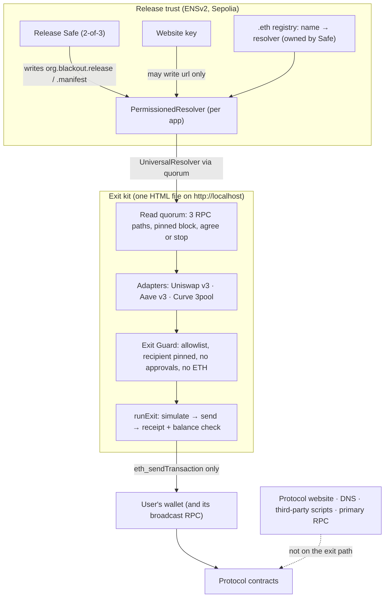

# BLACKOUT

**A saved, verifiable emergency exit for DeFi positions.** It keeps working when the protocol's website, domain, company or RPC provider fails or is hijacked.

> We take down the DeFi app's website, and you can still withdraw directly from its smart contracts.

BLACKOUT is one self-contained HTML file (the **exit kit**). Its fingerprint is published in the protocol's **ENSv2** name, together with the list of exit contracts. The kit finds your positions from your wallet and builds approval-free exit transactions. Every transaction passes a fail-closed **Exit Guard** before your wallet sees it. Reads go through a **3-path RPC quorum** that refuses to continue if the paths disagree.

**Honest claim:** if the website dies or is hijacked, you can still exit, and a hijacked site cannot trick the kit into an approval or a foreign recipient. BLACKOUT does **not** protect against smart-contract exploits, oracle attacks, stolen user keys, or paused or insolvent contracts (see [Honest limits](#honest-limits)).

---

## Quick start

```bash
corepack enable && pnpm install          # Node 22, pnpm 9
pnpm --filter @blackout/kit build        # → apps/kit/dist/blackout-kit.html (+ .sha256)

# Verify the file yourself, OUTSIDE the kit, against the ENS release record:
scripts/verify-kit.sh apps/kit/dist/blackout-kit.html demoswap-blackout.eth
#   MATCH v=2 <sha256>   or   MISMATCH expected … got …   (exit 1)

# Serve it on localhost (wallets do not inject into file:// pages):
npx serve apps/kit/dist      # or: python3 -m http.server -d apps/kit/dist
```

Open `http://localhost:3000/blackout-kit.html`, then:
1. Type the protocol's ENS name. Take it from the protocol's docs, never from the kit.
2. Connect your wallet.
3. Press **Exit** on each position.

"Recovered" appears only after a confirmed receipt **and** a positive balance change for every expected token.

The **Check a transaction** tab runs the same Exit Guard on anything a live site asks you to sign.

## What the demo proves

| Claim | Evidence | How to reproduce |
|---|---|---|
| A real withdrawal from the saved kit, with the website and primary RPC switched off | Drill e2e: site down + RPC down + DNS hijack, then 3 Uniswap v3 exits recovered, time-to-exit < 60 s | `cd apps/kit && pnpm exec playwright test e2e/drill.spec.ts` |
| A tampered kit is rejected by an independent fingerprint check against ENSv2 | `verify-kit.sh` → `MISMATCH` on the hijack's one-byte-tampered kit | drill report `tamperedKitDetected: true` |
| A stolen website key cannot change the release record or swap the resolver | 9 must-revert fork tests; on-chain reverted txs from the website key (live Sepolia hashes below once the live run is done) | `cd contracts && forge test --match-contract PermissionsForkTest`; [live hashes](#deployed-addresses-and-transactions) |
| The Exit Guard rejects real attacker calldata (Curve 2022) | Victim's real `approve` calldata → rejected (BANNED + TARGET) | `pnpm vitest run packages/guard/test/fixtures.test.ts` |
| Without BLACKOUT the Curve 2022 victim loses 400,227.23 USDC; with it, 0 | Foundry `vm.transact` replay on a mainnet fork | `cd replay && forge test` · report: [docs/replay/R1.md](docs/replay/R1.md) |
| The kit loads zero third-party code | Playwright network log: 0 third-party origins (DemoSwap: 4) | `pnpm exec playwright test e2e/no-trackers.spec.ts e2e/scan.spec.ts` |

## Architecture



Trust boundaries:
- **Trusted:** the wallet and its broadcast RPC, Ethereum, the ENS contracts, the release Safe's signers.
- **Verified, not trusted:** the kit file (sha256 against ENS, checked outside the kit), RPC answers (quorum), every exit call (Guard).
- **Not trusted at all:** the website, its DNS, its third-party scripts, wherever the kit is hosted.

**Trust roots inside the kit** ([config/networks.json](config/networks.json), hashed with the kit): the ENSv2 UniversalResolver proxy `0xeEeE…EeEe` on Sepolia and the default public RPC list. Protocol addresses are **not** in the kit. They come from the `org.blackout.manifest` record.

### Repo map

| Path | What |
|---|---|
| [`packages/core`](packages/core/src) | types, canonical signatures → selectors, minimal ABIs, manifest + release codecs |
| [`packages/guard`](packages/guard/src/guard.ts) | the Exit Guard (pure TS) and its plain-language `explain()` |
| [`packages/quorum`](packages/quorum/src/quorum.ts) | 3-path read quorum: 4 s timeout, 2 retries, ≥2 must answer, all must agree, pinned block |
| [`packages/ens`](packages/ens/src/records.ts) | reads `url`, `org.blackout.release`, `org.blackout.manifest`, `org.blackout.site` via UniversalResolverV2 |
| [`packages/adapters`](packages/adapters/src) | Uniswap v3, Aave v3 (supply-only), Curve 3pool |
| [`packages/exec`](packages/exec/src/run-exit.ts) | Guard → simulate → send → receipt → balance check; exit report |
| [`apps/kit`](apps/kit) | the single-file kit (Vite + Preact + viem, hashed CSP, reproducible build) |
| [`contracts`](contracts) | Foundry: ENSv2 setup via Safe, record writer, must-revert tests, Sepolia seed |
| [`harness`](harness) | Fire Drill: DemoSwap site, hijack clone, primary RPC proxy, router, judge control page |
| [`replay`](replay) | Incident Replay Lab: fixtures, Foundry `vm.transact` replays, kit exits at incident blocks |
| [`scripts/verify-kit.sh`](scripts/verify-kit.sh) | independent verifier (cast + sha256sum) |

### Uniswap v3 integration (for the Uniswap Foundation track)

- Discovery: [`packages/adapters/src/uniswap-v3.ts#L34-L59`](packages/adapters/src/uniswap-v3.ts#L34-L59) calls `balanceOf`, then `tokenOfOwnerByIndex`, then `positions(id)`.
- Exit: [`#L62-L98`](packages/adapters/src/uniswap-v3.ts#L62-L98) builds `multicall[decreaseLiquidity(min from simulation), collect(to user)]` in one transaction.
  - Positions with liquidity 0 that are still owed tokens get a `collect`-only exit ([`#L86`](packages/adapters/src/uniswap-v3.ts#L86)), because `decreaseLiquidity(0)` reverts.
  - Expected deltas list only tokens with a simulated amount > 0 ([`#L95`](packages/adapters/src/uniswap-v3.ts#L95)).
- Live on Sepolia and replayed on mainnet forks.

### Exit Guard rules ([`packages/guard/src/guard.ts#L45`](packages/guard/src/guard.ts#L45))

1. The chain must be listed in the manifest.
2. `to` must be an exit contract in the manifest.
3. Every selector, including those nested in a multicall, must be allowlisted for that target.
4. Every decoded recipient must be the connected account.
5. Pay-the-caller pools require `from` = the account.
6. Always banned: `approve`, `increaseAllowance`, EIP-2612 / DAI / ERC-721 permits, `setApprovalForAll`, `transfer(From)`, `safeTransferFrom`, Permit2.
7. `value` must be 0.

Any decode failure, unknown selector or quorum disagreement means reject, and the UI has no override.

Proven by a 26-case banned corpus (including the Curve 2022 victim's real calldata) and 10,000-run property tests.

## CROPS

| | How BLACKOUT meets it |
|---|---|
| **C**ensorship resistance (lead) | The exit needs no BLACKOUT server and no protocol server. The judge kills the website, the primary RPC and DNS live, and the exit still lands. Broadcast goes through the wallet's own RPC, which is a disclosed trusted dependency. |
| **O**pen source | MIT. Builds from this repo. Two builds on the same toolchain give the same sha256 (`apps/kit/scripts/check-repro.mjs`); cross-machine reproduction is not yet verified. |
| **P**rivacy | No server and no analytics. The kit contacts only the RPC endpoints you configure plus the bundled public ones (Playwright-verified: 0 third-party requests). RPC providers see reads for your address. Anon-RPC: see [docs/crops.md](docs/crops.md). |
| **S**ecurity | Keys stay in the wallet. The only transaction methods the kit calls are `eth_estimateGas` and `eth_sendTransaction` (plus `eth_requestAccounts`, `eth_chainId` and `wallet_switchEthereumChain` to connect), and it never asks for typed-data signatures. Every call passes the Exit Guard. Releases are published by a 2-of-3 Safe, and a stolen website key can write only `url`. In this testnet demo all three Safe owner keys were generated on one machine; a real protocol must use independent signers. |

More detail: [docs/crops.md](docs/crops.md).

## Deployed addresses and transactions

ENSv2 on Sepolia (verified on chain; see [docs/ens-notes.md](docs/ens-notes.md)):

| Contract | Address |
|---|---|
| UniversalResolver (proxy used by the kit) | `0xeEeEEEeE14D718C2B47D9923Deab1335E144EeEe` |
| ETHRegistrar | `0xf633e7fc17e2bbe0d0965d18ec1821dcb754a3d3` |
| VerifiableFactory | `0xda70306c98e97ece36f997a21368e53298572991` |
| PermissionedResolver implementation | `0x115eb53f0c60696633855f90b138178fb40b2b2c` |

Our deployment (`demoswap-blackout.eth`: Safe, resolver, must-revert transactions, seeded positions, exits) is written by `contracts/script/live-setup.sh` to `contracts/deployments/sepolia*.json`. **Status: pending the live Sepolia run.** Every line below is filled from those files once it has run.

<!-- LIVE-DEPLOYMENT:START -->
| What | Value |
|---|---|
| ENS name | `demoswap-blackout.eth` |
| Release Safe (2-of-3, name owner) | [`0x3ae03951044Ced07F7fa12072CfE7F95827A057F`](https://sepolia.etherscan.io/address/0x3ae03951044Ced07F7fa12072CfE7F95827A057F) |
| PermissionedResolver (per app) | [`0x642cD108b4EA8cb1e7617213533FfE1AcE8BDE82`](https://sepolia.etherscan.io/address/0x642cD108b4EA8cb1e7617213533FfE1AcE8BDE82) |
| Website key (url only) | [`0xA2f199fEd2Fecf201422C71e1E53C76Fd6f4d182`](https://sepolia.etherscan.io/address/0xA2f199fEd2Fecf201422C71e1E53C76Fd6f4d182) |
| Published kit sha256 (`org.blackout.release` v2) | `5c835ecc0f828a3313ef9830b3bdce4ec9d7b08804b2bf688ffbfdf95bd7e0fc` |

Must-revert checks, sent on chain from the website key:

| Check | Result | Tx |
|---|---|---|
| web key writes org.blackout.release (must revert) | reverted ✓ | [`0x1b1a7bc4…`](https://sepolia.etherscan.io/tx/0x1b1a7bc4b7f678a357b0d1993452a1ce105b7db892f8cae3caeb8c75090bd300) |
| web key swaps resolver on registry (must revert) | reverted ✓ | [`0x9bb6e55f…`](https://sepolia.etherscan.io/tx/0x9bb6e55ffe8aa145355aacd41183170629eaa11b55bf6b5ef3a61a768e4b974f) |
| web key upgrades resolver proxy (must revert) | reverted ✓ | [`0x3129c636…`](https://sepolia.etherscan.io/tx/0x3129c6369ea6997a8b81b7657f1e7863622d332a5b8a596e3a200d7524b963d6) |
| web key grants itself the release setter (must revert) | reverted ✓ | [`0x6cbc3b4d…`](https://sepolia.etherscan.io/tx/0x6cbc3b4dc02366fad33e1cb4ed0bccd19c9435bcede24e6a64e36770877a2b97) |
| web key grants itself root text role (must revert) | reverted ✓ | [`0xd8c7b6e7…`](https://sepolia.etherscan.io/tx/0xd8c7b6e7459f0a808c83d670a278841b9dcab535ebec52cb1b75ba0496beb9ed) |
| web key writes url (must succeed) | succeeded ✓ | [`0xe36172b9…`](https://sepolia.etherscan.io/tx/0xe36172b98a22910e241c11119a940e813c9f436c5dee03a99fb7fa6e9db0ecec) |

Seeded Uniswap v3 positions (owner [`0xa9e11dfe4115c9193057533A0DAf56A59d1A7CF4`](https://sepolia.etherscan.io/address/0xa9e11dfe4115c9193057533A0DAf56A59d1A7CF4)): #234133 in range, #234134 out of range, #234135 owed only.
<!-- LIVE-DEPLOYMENT:END -->

## Running everything

```bash
pnpm test                    # unit: core, guard (+10k property runs), quorum, ens, exec, kit, harness, replay schema
pnpm test:fork               # anvil mainnet forks: Uniswap v3 / Aave v3 / Curve exits, R1 kit exits at block 15309928
cd contracts && SEPOLIA_RPC=… forge test     # ENSv2 setup + must-revert on a Sepolia fork
cd replay && forge test      # R1 as it happened vs counterfactual (archive RPC: ARCHIVE_RPC, default Tenderly public)
cd apps/kit && pnpm exec playwright test     # e2e: full exit, check-a-transaction, no trackers, fire drill, scan

# Fire drill by hand (process mode; Docker mode: docker compose -f harness/docker-compose.yml up --build)
PRIMARY_RPC=https://… ENS_NAME=demoswap-blackout.eth pnpm --filter @blackout/harness start
#   control http://localhost:8090 · site http://demoswap.localhost:8080 · kit http://localhost:8000

pnpm --filter @blackout/replay replay R1      # writes replay/out/R1.{md,html}
```

Wallets: the e2e uses an injected EIP-6963 test wallet. Manual checks with MetaMask and Rabby on `http://localhost`: **pending**.

## Honest limits

- Does not stop smart-contract exploits (the replay control C1 shows this).
- Still trusted: the user's wallet and its broadcast RPC, Ethereum itself, ENS, the release Safe's signers, and `sha256sum`. In this testnet demo the Safe's three owner keys sit on one machine (`contracts/.env`), so the 2-of-3 property is demonstrated, not independent.
- The MVP covers Uniswap v3 NFTs held directly, Aave v3 supply-only, and Curve 3pool LP. It does not cover Uniswap v4, vaults or staked positions. Aave positions with debt are flagged "manual", because repaying needs an approval.
- The user must save or fetch the kit, and must know the ENS name from a source other than the kit.
- ENSv2 resolver roles are per resolver, not per name. We deploy one resolver per protocol name, so the web key's `url` grant covers exactly that one name.
- The kit warns when it sees a lower release version than one seen before in this browser. On-chain monotonicity is not enforced. Serving an older record needs either the release Safe or a majority of the kit's RPC paths lying together (a single path reporting an old block is ignored: heads more than 16 blocks from the median are dropped).
- Replays are labelled **mainnet fork**, **impersonated account** and **counterfactual**. None is a live mainnet rescue.

## License and disclosures

MIT ([LICENSE](LICENSE)). AI use: [docs/ai-use.md](docs/ai-use.md). Partner feedback: [FEEDBACK.md](FEEDBACK.md).
