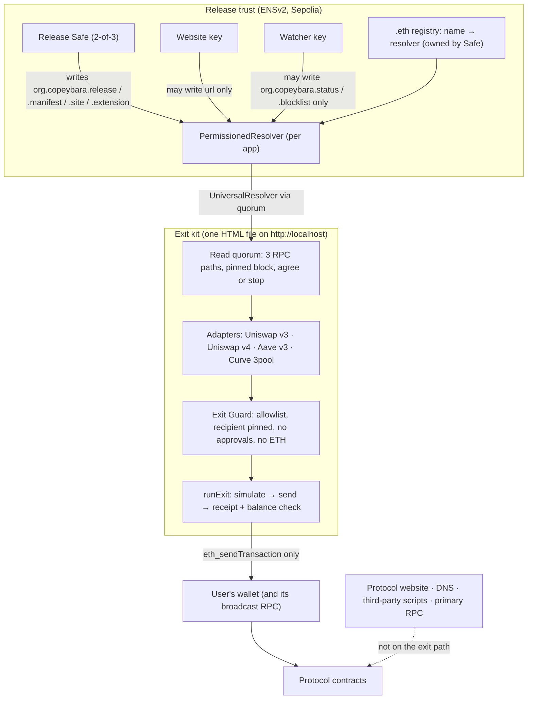

# Copeybara

**Live: https://blackout-red.vercel.app** · try the kit on the demo protocol: https://blackout-red.vercel.app/copeybara-kit.html?ens=demoswap-blackout.eth (Sepolia wallet)

**A saved, verifiable emergency exit for DeFi positions.** It keeps working when the protocol's website, domain, company or RPC provider fails or is hijacked.

> We take down the DeFi app's website, and you can still withdraw directly from its smart contracts.

Copeybara is one self-contained HTML file (the **exit kit**). Its fingerprint is published in the protocol's **ENSv2** name, together with the list of exit contracts. The kit finds your positions from your wallet and builds approval-free exit transactions. Every transaction passes a fail-closed **Exit Guard** before your wallet sees it. Reads go through a **3-path RPC quorum** that refuses to continue if the paths disagree.

The optional **Copeybara browser extension** adds a proactive layer: it checks protocol sites against the script fingerprints the protocol published on ENS, stops drainer approvals and permits before the wallet shows them, and offers a one-click exit through the verified kit when a site is down or hijacked (see [Browser extension](#browser-extension)).

**Honest claim:** if the website dies or is hijacked, you can still exit, and a hijacked site cannot trick the kit into an approval or a foreign recipient. Copeybara does **not** protect against smart-contract exploits, oracle attacks, stolen user keys, or paused or insolvent contracts (see [Honest limits](#honest-limits)).

---

## Quick start

```bash
corepack enable && pnpm install          # Node 22, pnpm 9
pnpm --filter @copeybara/kit build        # → apps/kit/dist/copeybara-kit.html (+ .sha256)

# Verify the file yourself, OUTSIDE the kit, against the ENS release record:
scripts/verify-kit.sh apps/kit/dist/copeybara-kit.html demoswap-blackout.eth
#   MATCH v=<release> <sha256>   or   MISMATCH expected … got …   (exit 1)

# Serve it on localhost (wallets do not inject into file:// pages):
npx serve apps/kit/dist      # or: python3 -m http.server -d apps/kit/dist
```

Open `http://localhost:3000/copeybara-kit.html`, then:
1. Type the protocol's ENS name. Take it from the protocol's docs, never from the kit.
2. Connect your wallet.
3. Press **Exit** on each position.

"Recovered" appears only after a confirmed receipt **and** a positive balance change for every expected token.

While an exit runs, the kit shows each stage live (Exit Guard check → rehearsal on the RPC quorum → waiting for your wallet → waiting for a block, with the transaction link → balance check). Errors are explained in plain language with one fix: switch or add the network, get Sepolia ETH for fees, add your own RPC, or check the ENS name.

The **Check a transaction** tab runs the same Exit Guard on anything a live site asks you to sign.

## What the demo proves

| Claim | Evidence | How to reproduce |
|---|---|---|
| A real withdrawal from the saved kit, with the website and primary RPC switched off | Drill e2e: site down + RPC down + DNS hijack, then 3 Uniswap v3 exits recovered, time-to-exit < 60 s | `cd apps/kit && pnpm exec playwright test e2e/drill.spec.ts` |
| A tampered kit is rejected by an independent fingerprint check against ENSv2 | `verify-kit.sh` → `MISMATCH` on the hijack's one-byte-tampered kit | drill report `tamperedKitDetected: true` |
| A stolen website key cannot change the release record or swap the resolver | 9 must-revert fork tests; on-chain reverted txs from the website key (live Sepolia hashes below) | `cd contracts && forge test --match-contract PermissionsForkTest`; [live hashes](#deployed-addresses-and-transactions) |
| The Exit Guard rejects real attacker calldata (Curve 2022) | Victim's real `approve` calldata → rejected (BANNED + TARGET) | `pnpm vitest run packages/guard/test/fixtures.test.ts` |
| Without Copeybara the Curve 2022 victim loses 400,227.23 USDC; with it, 0 | Foundry `vm.transact` replay on a mainnet fork | `cd replay && forge test` · report: [docs/replay/R1.md](docs/replay/R1.md) |
| A Uniswap v4 exit (not enumerable, action-list calldata) works against the real v4 contracts | Sepolia fork: mint via Permit2 → log-scan discovery → Guard → quorum simulation → send → "Recovered", preview = received to the wei | `pnpm vitest run -c vitest.fork.config.ts packages/exec/test/uniswap-v4.fork.test.ts` |
| The kit loads zero third-party code | Playwright network log: 0 third-party origins (DemoSwap: 4) | `pnpm exec playwright test e2e/no-trackers.spec.ts e2e/scan.spec.ts` |

## Live demo: the Attack Theater

The website (`apps/site`) explains Copeybara, offers the extension zip with its sha256, and embeds a four-chapter **real attack replication on Sepolia**:
1. **A normal day:** a victim wallet gets 10,000 DUSD and a Uniswap v3 position.
2. **The hijack:** DemoSwap's domain is hijacked. The fake site asks for `approve(drainer, max)`, and the attacker's bot drains the wallet within seconds. This is a real transaction, labelled *Without Copeybara*.
3. **The outage:** the website and the protocol's RPC are switched off for real.
4. **The rescue:**
   - the saved kit matches its ENS fingerprint, and the hijacker's kit does not;
   - the kit's Exit Guard blocks the exact request the fake site sent;
   - the position is withdrawn straight from the contracts.

   A scoreboard shows what was lost and what was recovered, with every transaction link.

```bash
pnpm --filter @copeybara/kit build && pnpm --filter @copeybara/site build
pnpm --filter @copeybara/harness start          # needs contracts/.env (DEPLOYER_KEY, ATTACKER_KEY) and deployments/sepolia-attack.json
npx serve apps/site/dist -l 4173               # then open:
#   http://localhost:4173/?booth=http://localhost:8090
```

- **Victim wallet:** use a *second* MetaMask account (e.g. "Account 2"). Never use a wallet holding real funds.
- **To see the demo tokens in MetaMask:** go to *Import tokens* and add DUSD `0x79c2D3B20e12c95243C2FeBaE903999912fc6EcA` and DETH `0x62715d2762949Ab8Fb124eB01f78898Feb8a596A`.
- **No booth?** Without `?booth=`, the same section shows the public live proof: the ENS release read live, the stolen-key attacks reverting on chain, and the last recorded run.
- **Fallback:** with `THEATER_NETWORK=local-fork THEATER_RPC=<anvil url>`, every screen carries a **LOCAL FORK** banner.
- **Rehearsal:** `cd apps/kit && pnpm exec tsx e2e-live/rehearse-live.ts` runs all four chapters headless on real Sepolia with a throwaway victim, and records `demo-runs/latest.json`.

## Architecture



Trust boundaries:
- **Trusted:** the wallet and its broadcast RPC, Ethereum, the ENS contracts, the release Safe's signers.
- **Verified, not trusted:** the kit file (sha256 against ENS, checked outside the kit), RPC answers (quorum), every exit call (Guard).
- **Not trusted at all:** the website, its DNS, its third-party scripts, wherever the kit is hosted.

**Old records stay frozen, so saved kits never break.** Before the rename to Copeybara the records were `org.blackout.release`, `org.blackout.manifest` (Uniswap v3, Aave v3, Curve 3pool) and `org.blackout.manifest2` (adds Uniswap v4). They stay on chain, unchanged, so kits saved before the rename keep reading them and keep working. Current kits and the extension read the `org.copeybara.*` keys below, which the Safe writes once to migrate. Kits skip protocols they do not know instead of stopping.

### ENS records

All on the protocol's ENS name (here `demoswap-blackout.eth`), read through the RPC quorum at one pinned block ([`packages/ens`](packages/ens/src/records.ts), codecs in [`packages/core`](packages/core/src/records.ts)). The kit needs `release` and `manifest`; the rest are optional, and a malformed optional record is reported, never shown as fine.

| Key | Written by | Holds |
|---|---|---|
| `org.copeybara.release` | Safe (2-of-3) | the kit's sha256 and version |
| `org.copeybara.manifest` | Safe (2-of-3) | exit contracts and allowed functions, per chain |
| `org.copeybara.site` | Safe (2-of-3) | the site fingerprint: the set of sha256 hashes of every script the official site may run |
| `org.copeybara.extension` | Safe (2-of-3) | the Chrome extension zip's sha256 and version |
| `org.copeybara.status` | Safe or watcher key | `ok` / `degraded` / `compromised`, a time and a short note |
| `org.copeybara.blocklist` | Safe or watcher key | look-alike domains to block (each host and its subdomains) |

`url` (the official site's origin) is the only record the website key can write. `status` and `blocklist` can only warn about or block *websites*; nothing in them can block an exit.

**Trust roots inside the kit** ([config/networks.json](config/networks.json), hashed with the kit): the ENSv2 UniversalResolver proxy `0xeEeE…EeEe` on Sepolia and the default public RPC list. Protocol addresses are **not** in the kit. They come from the `org.copeybara.manifest` record.

### Repo map

| Path | What |
|---|---|
| [`packages/core`](packages/core/src) | types, canonical signatures → selectors, minimal ABIs, manifest + release codecs |
| [`packages/guard`](packages/guard/src/guard.ts) | the Exit Guard (pure TS) and its plain-language `explain()` |
| [`packages/quorum`](packages/quorum/src/quorum.ts) | 3-path read quorum: 4 s timeout, 2 retries, ≥2 must answer, all must agree, pinned block |
| [`packages/ens`](packages/ens/src/records.ts) | reads `url` and the six `org.copeybara.*` records via UniversalResolverV2 |
| [`packages/sitecheck`](packages/sitecheck/src/index.ts) | site fingerprint: script hashing, set check (match / mismatch / unverifiable / unset), static script extraction |
| [`packages/adapters`](packages/adapters/src) | Uniswap v3, Uniswap v4 (ERC-20 pairs), Aave v3 (supply-only), Curve 3pool |
| [`packages/exec`](packages/exec/src/run-exit.ts) | Guard → simulate → send → receipt → balance check; exit report |
| [`apps/kit`](apps/kit) | the single-file kit (Vite + Preact + viem, hashed CSP, reproducible build) |
| [`apps/extension`](apps/extension) | the browser extension (MV3 Chrome; Firefox build best effort), reproducible zips |
| [`apps/watcher`](apps/watcher) | the watcher agent: fingerprints the official site and look-alikes, writes `status` / `blocklist` |
| [`apps/site`](apps/site) | the public website, extension download and the Attack Theater |
| [`contracts`](contracts) | Foundry: ENSv2 setup via Safe, record writer, must-revert tests, Sepolia seed |
| [`harness`](harness) | Fire Drill: DemoSwap site, hijack clone, primary RPC proxy, router, judge control page |
| [`replay`](replay) | Incident Replay Lab: fixtures, Foundry `vm.transact` replays, kit exits at incident blocks |
| [`scripts/verify-kit.sh`](scripts/verify-kit.sh) | independent verifier (cast + sha256sum) |

### Uniswap v3 and v4 integration (for the Uniswap Foundation track)

**Uniswap v4** ([`packages/adapters/src/uniswap-v4.ts`](packages/adapters/src/uniswap-v4.ts)):
- Discovery ([`#L84-L107`](packages/adapters/src/uniswap-v4.ts#L84-L107)): v4 position NFTs are not enumerable, so the kit reads `balanceOf` for the true count, scans recent `Transfer(→ user)` logs in 10k-block chunks through the RPC quorum ([`#L30`](packages/adapters/src/uniswap-v4.ts#L30)), and confirms each id with `ownerOf`. If it finds fewer than the wallet owns, it says how many are missing, and the user adds them by ID ([`byId`, `#L109-L121`](packages/adapters/src/uniswap-v4.ts#L109-L121)); the kit checks ownership first.
- Exit ([`#L128-L166`](packages/adapters/src/uniswap-v4.ts#L128-L166)): one `modifyLiquidities` call with `[DECREASE_LIQUIDITY(all liquidity, mins), TAKE_PAIR(currency0, currency1, user)]`. Minimums are the principal from v4 math at the pinned block minus slippage ([`v4-math.ts`](packages/adapters/src/v4-math.ts): `TickMath` / `SqrtPriceMath` ported to bigint; all 21 constants diffed against the Uniswap source). The preview adds fees owed from `StateView` fee growth.
- Exit Guard ([`decodeV4`](packages/guard/src/decode.ts#L76-L113)): decodes the action list. Only `DECREASE_LIQUIDITY`, `BURN_POSITION` and `TAKE_PAIR` to the user are allowed. `SETTLE*` / `CLOSE_CURRENCY` / `MINT` / `INCREASE` (they can pull tokens through an existing Permit2 allowance), `SWEEP`, `TAKE*` and swaps are banned with a plain reason; unknown action codes fail closed.
- Proven on a Sepolia fork against the real PoolManager, PositionManager and StateView ([`packages/exec/test/uniswap-v4.fork.test.ts`](packages/exec/test/uniswap-v4.fork.test.ts)): mint through Permit2, discover by log scan, exit through the kit's own `runExit`. "Recovered", and the previewed amounts equal what arrived, to the wei. Live on Sepolia: positions #41448 and #41449 in the demo wallet.

**Uniswap v3:**

- Discovery: [`packages/adapters/src/uniswap-v3.ts#L34-L59`](packages/adapters/src/uniswap-v3.ts#L34-L59) calls `balanceOf`, then `tokenOfOwnerByIndex`, then `positions(id)`.
- Exit: [`#L62-L102`](packages/adapters/src/uniswap-v3.ts#L62-L102) builds `multicall[decreaseLiquidity(min from simulation), collect(to user)]` in one transaction.
  - Positions with liquidity 0 that are still owed tokens get a `collect`-only exit ([`#L86`](packages/adapters/src/uniswap-v3.ts#L86)), because `decreaseLiquidity(0)` reverts.
  - Expected deltas list only tokens with a simulated amount > 0 ([`#L95`](packages/adapters/src/uniswap-v3.ts#L95)).
- Live on Sepolia and replayed on mainnet forks.

### Exit Guard rules ([`packages/guard/src/guard.ts#L45`](packages/guard/src/guard.ts#L45))

1. The chain must be listed in the manifest.
2. `to` must be an exit contract in the manifest.
3. Every selector, including those nested in a multicall, must be allowlisted for that target.
4. Every decoded recipient must be the connected account.
5. Pay-the-caller pools require `from` = the account.
6. Always banned: `approve`, `increaseAllowance`, EIP-2612 / DAI / ERC-721 permits, `setApprovalForAll`, `transfer(From)`, `safeTransferFrom`, Permit2. Inside a Uniswap v4 `modifyLiquidities`, every action except `DECREASE_LIQUIDITY`, `BURN_POSITION` and `TAKE_PAIR` is banned.
7. `value` must be 0.

Any decode failure, unknown selector or quorum disagreement means reject, and the UI has no override.

Proven by a 39-case banned corpus (including the Curve 2022 victim's real calldata and 13 Uniswap v4 action-list attacks), 10,000-run property tests, and a 2,000-run v4 property test (accepted exactly when every action is an exit action and every payout goes to the user).

## Browser extension

[`apps/extension`](apps/extension) is an MV3 extension for Chrome (a Firefox build is produced, best effort), installed unpacked from `copeybara-extension-chrome.zip`. The zip is built reproducibly (`node apps/extension/scripts/build.mjs`, fixed timestamps, sorted entries) and its sha256 is what the Safe publishes as `org.copeybara.extension`. The website offers it for download with its sha256.

**Architecture: one place decides.**
- **Service worker = trust core.** The only writer of extension storage. It reads ENS through the 3-RPC quorum, computes every verdict, and checks each message's sender with Chrome's own `sender` data (extension id, tab, origin). It never trusts a verdict or data claimed by a page, and rate-limits each tab.
- **Content script (isolated world)** observes every script a page runs from `document_start`, hashes it, and relays wallet requests to the worker. It has no storage access.
- **MAIN-world shim** wraps `window.ethereum` and EIP-6963 providers (`eth_sendTransaction`, `eth_signTypedData*`, `personal_sign`, `eth_sign`, `wallet_sendCalls`) and waits for the worker's answer. It decides nothing; a blocked request is rejected with EIP-1193 code 4001.
- **Trusted UI only:** the toolbar badge and popup, setup wizard, dashboard, warning page and confirm window are extension pages. Verdicts are never drawn inside the web page.

**What it checks.**
- **Site fingerprint** = the set of sha256 hashes of every script the official site may run (`org.copeybara.site`, hashing shared with the watcher in [`packages/sitecheck`](packages/sitecheck/src/index.ts)). Any script outside the set is a mismatch, and the tab is replaced by the warning page. A script that cannot be re-read is "can't verify" (amber), never green.
- **Blocked before load:** `declarativeNetRequest` rules cancel main-frame loads of a followed protocol's site while its ENS `status` is `compromised`, and of every domain on its `blocklist`; the worker then moves the tab to the warning page. Not a byte of the site runs.
- **Wallet request verdicts** ([`packages/guard/src/classify.ts`](packages/guard/src/classify.ts)): `exit` (passes the Exit Guard for a followed protocol), `known` (a contract in a followed manifest), `unknown` (an ordinary call to a contract no followed protocol lists), `risky` (an approval or permit to a followed protocol's contract, ETH to an unknown address, unreadable data) and `dangerous` (approve / permit / Permit2 / transfer to an address no followed protocol publishes, `eth_sign`, signing a bare 32-byte hash). Requests that move nothing (`pass`) go straight through. `risky` and `dangerous` open a confirm window; `dangerous` defaults to Cancel. On a site that failed its fingerprint check every request is blocked.
- **Stats are local only:** sites checked, verified, mismatched, unverifiable, pages blocked, requests checked and blocked are counted by the worker in extension storage and never sent anywhere.

**Honest limits of the extension.**
- In-page interception is best effort: a hostile page can bypass code running inside it (for example, by talking to the wallet before the shim wraps it). The authoritative blocks are the worker's: `declarativeNetRequest` before load, and replacing the tab on a mismatch.
- Chrome cannot fully prove which bytes ran. The content script re-reads each external script with `fetch(src, { cache: 'force-cache' })`, so it hashes the browser's cached copy (cache first), which is normally, but not provably, the copy that executed.
- It protects people who installed it and follow the protocol. It is a Sepolia testnet preview, installed unpacked, not published in any store.

```bash
node apps/extension/scripts/build.mjs          # → apps/extension/dist/{chrome,firefox}/ + copeybara-extension-{chrome,firefox}.zip (+ .sha256)
cd apps/extension && pnpm e2e                  # Playwright with the real unpacked extension
```

Install: unzip `copeybara-extension-chrome.zip` → open `chrome://extensions` → turn on **Developer mode** → **Load unpacked** and pick the folder. The setup wizard opens (wallet → protocols to follow → RPC services → done).

## Watcher agent

[`apps/watcher`](apps/watcher) is an always-on agent a protocol runs for its own name. Each tick it fingerprints the official site (the `url` record) against `org.copeybara.site`, and probes a configured list of look-alike domains.

- **Role-scoped ENS key.** The watcher key is granted setter roles on `org.copeybara.status` and `org.copeybara.blocklist` only (`grantWatcherRoles`). Fork tests in [`contracts/test/Permissions.fork.t.sol`](contracts/test/Permissions.fork.t.sol) prove it cannot write `release`, `manifest`, `site`, `extension`, `url` or the contenthash, and cannot grant itself roles. A stolen watcher key can only raise or clear warnings; every extension still fingerprints the site itself, and no record can block an exit.
- **2 mismatches in a row → `status=compromised`.** Every extension following the protocol then blocks the site before it loads. 3 failed fetches in a row → `degraded`; 5 clean checks in a row clear the alarm.
- **It only clears alarms it raised itself.** A `compromised` status set by the Safe stays until the Safe changes it.
- A look-alike domain that serves pages is added to `org.copeybara.blocklist`.
- **Optional Claude note.** With `ANTHROPIC_API_KEY` set, Claude writes the short warning shown on the warning page, from structured facts only (protocol, kind, script URLs or labels; never page content), capped at 200 characters. Without the key, or on any error, a fixed deterministic note is used.

```bash
WATCHER_KEY=0x… WATCH_NAMES=demoswap-blackout.eth pnpm --filter @copeybara/watcher start   # optional: CANDIDATES, STATUS_PORT, ANTHROPIC_API_KEY
```

## CROPS

| | How Copeybara meets it |
|---|---|
| **C**ensorship resistance (lead) | **What we/the protocol control that users depend on, and what happens if it goes away:**<br>• the protocol's **website + DNS** → users open their saved kit (or any mirror); the drill switches the site off live and exits still land;<br>• the **primary RPC** → the kit reads through 3 independent providers (≥2 must answer and agree), so one dead RPC is tolerated (the other two still agree), and one lying RPC makes the kit stop safely instead of acting on a wrong answer;<br>• **this website host** (Vercel, https://blackout-red.vercel.app) → only a convenience; the kit file is verified against ENS, so any copy works. After one visit, the page and the kit keep opening from the browser's cache when the host is down (same-origin service worker, e2e-tested by switching a copy of the site off);<br>• the **release Safe** → if it never publishes again, the last ENS release stays valid; it cannot block an exit;<br>• **no Copeybara server exists** on the exit path.<br>What users still depend on: their **wallet's RPC** to broadcast (they can switch it) and Ethereum itself. |
| **O**pen source | MIT. Anyone can build and run it from this repo alone (`pnpm install && pnpm --filter @copeybara/kit build`). Two builds on the same toolchain give the same sha256 (`apps/kit/scripts/check-repro.mjs`); cross-machine reproduction is not yet verified. |
| **P**rivacy | **What each third party learns:**<br>• **RPC providers** (publicnode, Tenderly, ethPandaOps, or your own): your address and the contracts you query, plus your IP;<br>• **your wallet's RPC**: the exit transaction you send;<br>• **the website host** (Vercel), only if you open the hosted copy: that the page and kit file were fetched, plus your IP. A downloaded kit contacts no host;<br>• **no Copeybara server, no analytics, no trackers**: Playwright-verified, 0 third-party requests from the kit.<br>Anon-RPC: see [docs/crops.md](docs/crops.md). |
| **S**ecurity | Keys stay in the wallet. The only transaction methods the kit calls are `eth_estimateGas` and `eth_sendTransaction` (plus `eth_requestAccounts`, `eth_chainId`, `wallet_switchEthereumChain`, and `wallet_addEthereumChain` only when the wallet does not know the network; the network check also runs before each exit), and it never asks for typed-data signatures. Every call passes the Exit Guard. Releases are published by a 2-of-3 Safe, and a stolen website key can write only `url`. In this testnet demo all three Safe owner keys were generated on one machine; a real protocol must use independent signers. |

More detail: [docs/crops.md](docs/crops.md).

## Deployed addresses and transactions

ENSv2 on Sepolia (verified on chain; see [docs/ens-notes.md](docs/ens-notes.md)):

| Contract | Address |
|---|---|
| UniversalResolver (proxy used by the kit) | `0xeEeEEEeE14D718C2B47D9923Deab1335E144EeEe` |
| ETHRegistrar | `0xf633e7fc17e2bbe0d0965d18ec1821dcb754a3d3` |
| VerifiableFactory | `0xda70306c98e97ece36f997a21368e53298572991` |
| PermissionedResolver implementation | `0x115eb53f0c60696633855f90b138178fb40b2b2c` |

Our deployment (`demoswap-blackout.eth`: Safe, resolver, must-revert transactions, seeded positions, exits) is written by `contracts/script/live-setup.sh` to `contracts/deployments/sepolia*.json`. The live Sepolia run is done; the block below is generated from those files by `node scripts/readme-live.mjs`. Entries recorded before the rename name the `org.blackout.*` keys that were live then.

<!-- LIVE-DEPLOYMENT:START -->
| What | Value |
|---|---|
| ENS name | `demoswap-blackout.eth` |
| Release Safe (2-of-3, name owner) | [`0x3ae03951044Ced07F7fa12072CfE7F95827A057F`](https://sepolia.etherscan.io/address/0x3ae03951044Ced07F7fa12072CfE7F95827A057F) |
| PermissionedResolver (per app) | [`0x642cD108b4EA8cb1e7617213533FfE1AcE8BDE82`](https://sepolia.etherscan.io/address/0x642cD108b4EA8cb1e7617213533FfE1AcE8BDE82) |
| Website key (url only) | [`0xA2f199fEd2Fecf201422C71e1E53C76Fd6f4d182`](https://sepolia.etherscan.io/address/0xA2f199fEd2Fecf201422C71e1E53C76Fd6f4d182) |
| Published kit sha256 (`org.blackout.release` v4) | `5485e76be539ca554d1798f47a3bf50ef2c18d8657a206a271ccdb502a53c561` |

Must-revert checks, sent on chain from the website key:

| Check | Result | Tx |
|---|---|---|
| web key writes org.blackout.release (must revert) | reverted ✓ | [`0x1b1a7bc4…`](https://sepolia.etherscan.io/tx/0x1b1a7bc4b7f678a357b0d1993452a1ce105b7db892f8cae3caeb8c75090bd300) |
| web key swaps resolver on registry (must revert) | reverted ✓ | [`0x9bb6e55f…`](https://sepolia.etherscan.io/tx/0x9bb6e55ffe8aa145355aacd41183170629eaa11b55bf6b5ef3a61a768e4b974f) |
| web key upgrades resolver proxy (must revert) | reverted ✓ | [`0x3129c636…`](https://sepolia.etherscan.io/tx/0x3129c6369ea6997a8b81b7657f1e7863622d332a5b8a596e3a200d7524b963d6) |
| web key grants itself the release setter (must revert) | reverted ✓ | [`0x6cbc3b4d…`](https://sepolia.etherscan.io/tx/0x6cbc3b4dc02366fad33e1cb4ed0bccd19c9435bcede24e6a64e36770877a2b97) |
| web key grants itself root text role (must revert) | reverted ✓ | [`0xd8c7b6e7…`](https://sepolia.etherscan.io/tx/0xd8c7b6e7459f0a808c83d670a278841b9dcab535ebec52cb1b75ba0496beb9ed) |
| web key writes url (must succeed) | succeeded ✓ | [`0xe36172b9…`](https://sepolia.etherscan.io/tx/0xe36172b98a22910e241c11119a940e813c9f436c5dee03a99fb7fa6e9db0ecec) |

Seeded Uniswap v3 positions (owner [`0xa9e11dfe4115c9193057533A0DAf56A59d1A7CF4`](https://sepolia.etherscan.io/address/0xa9e11dfe4115c9193057533A0DAf56A59d1A7CF4)): #234133 in range, #234134 out of range, #234135 owed only.

Seeded Uniswap v4 positions (owner [`0xa9e11dfe4115c9193057533A0DAf56A59d1A7CF4`](https://sepolia.etherscan.io/address/0xa9e11dfe4115c9193057533A0DAf56A59d1A7CF4), DETH/DUSD 0.3% pool `0x50e3c5a1…`): #41448 in range, #41449 out of range.
<!-- LIVE-DEPLOYMENT:END -->

## Running everything

```bash
pnpm test                    # unit: core, guard (+10k property runs), quorum, ens, exec, kit, harness, replay schema
pnpm test:fork               # anvil forks: Uniswap v3 / Aave v3 / Curve exits (mainnet), Uniswap v4 exits (Sepolia), R1 kit exits at block 15309928
cd contracts && SEPOLIA_RPC=… forge test     # ENSv2 setup + must-revert on a Sepolia fork
cd replay && forge test      # R1 as it happened vs counterfactual (archive RPC: ARCHIVE_RPC, default Tenderly public)
cd apps/kit && pnpm exec playwright test     # e2e: full exit, check-a-transaction, no trackers, fire drill, scan
node apps/extension/scripts/build.mjs && pnpm --filter @copeybara/site build   # the site build copies the kit and the extension zips (fails if either is missing)
cd apps/extension && pnpm e2e                # extension e2e: real unpacked extension

# Fire drill by hand (process mode; Docker mode: docker compose -f harness/docker-compose.yml up --build)
PRIMARY_RPC=https://… ENS_NAME=demoswap-blackout.eth pnpm --filter @copeybara/harness start
#   control http://localhost:8090 · site http://demoswap.localhost:8080 · kit http://localhost:8000

pnpm --filter @copeybara/replay replay R1      # writes replay/out/R1.{md,html}
```

Wallets: the automated e2e (kit and extension) uses an injected EIP-6963 test wallet, not a real wallet extension. Checks with real wallet extensions (MetaMask, Rabby) on Sepolia are a manual run-through by the maintainer: not automated, and not recorded as evidence in this repo.

## Honest limits

- Does not stop smart-contract exploits (the replay control C1 shows this).
- Still trusted: the user's wallet and its broadcast RPC, Ethereum itself, ENS, the release Safe's signers, and `sha256sum`. In this testnet demo the Safe's three owner keys sit on one machine (`contracts/.env`), so the 2-of-3 property is demonstrated, not independent.
- Covered: Uniswap v3 and v4 NFTs held directly, Aave v3 supply-only, and Curve 3pool LP. Not covered: vaults, staked positions, and Uniswap v4 pools that pay native ETH (listed as "manual"; the balance check would have to net out gas). Uniswap v4 discovery searches the last ~50k blocks; older positions are added by ID. A v4 hook that takes a cut on withdrawal can push the payout under the minimum: the simulation then fails and nothing is sent. Aave positions with debt are flagged "manual", because repaying needs an approval.
- The user must save or fetch the kit, and must know the ENS name from a source other than the kit.
- The website's offline copy (service worker) covers the website going **down**, not being **hijacked**: a hijacked host can replace it. Check the kit's sha256 against ENS (`scripts/verify-kit.sh`) or keep your own downloaded copy.
- ENSv2 resolver roles are per resolver, not per name. We deploy one resolver per protocol name, so the web key's `url` grant covers exactly that one name.
- The kit warns when it sees a lower release version than one seen before in this browser. On-chain monotonicity is not enforced. Serving an older record needs either the release Safe or a majority of the kit's RPC paths lying together (a single path reporting an old block is ignored: heads more than 16 blocks from the median are dropped).
- The browser extension's in-page checks are best effort, and Chrome cannot prove which script bytes ran (see [Browser extension](#browser-extension)).
- Replays are labelled **mainnet fork**, **impersonated account** and **counterfactual**. None is a live mainnet rescue.

## License and disclosures

MIT ([LICENSE](LICENSE)). AI use: [docs/ai-use.md](docs/ai-use.md). Partner feedback: [FEEDBACK.md](FEEDBACK.md).
